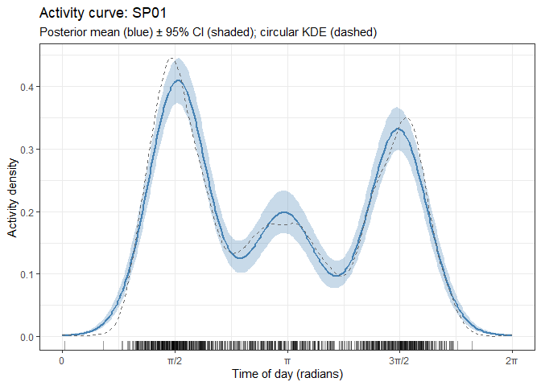

# ctrest

**ctrest** is an R package for estimating the density of ground-dwelling
mammals and birds from **camera-trap video data** using the **REST**
(Random Encounter and Staying Time) model or the **RAD-REST** (Random
Encounter and Staying Time model Relying on All Detections) model.

Both models are non-invasive, require no individual recognition, and
work with standard video recordings from fixed camera traps.

------------------------------------------------------------------------

## Background

The REST model estimates animal density from two key measurements
recorded for every video clip:

1.  **Number of passes** — how many times the animal entered the focal
    area (the area clearly visible in the camera’s field of view) in
    that clip.
2.  **Staying time** — how long the animal spent inside the focal area.

Combined with **camera trapping effort** (days) and an estimate of the
**proportion of time the animal is active**, the REST model derives
density without requiring a conventional distance-sampling survey
(Nakashima et al. 2018).

The **RAD-REST** model is an extension that relaxes the requirement of
counting passes in every video: it is sufficient to count passes in a
random subsample, which greatly reduces the annotation workload
(Nakashima et al. 2026).

------------------------------------------------------------------------

## Installation

``` r
# install.packages("devtools")
devtools::install_github("YoshihiroNakashima/ctrest", build_vignettes = TRUE)
```

For a guided tour after installation:

``` r
library(ctrest)
```

### System requirements

- R ≥ 4.1
- [NIMBLE](https://r-nimble.org/) is used internally for Bayesian MCMC.
  On Windows, [Rtools](https://cran.r-project.org/bin/windows/Rtools/)
  must be installed. On macOS, Xcode Command Line Tools are required.
- A multi-core CPU is strongly recommended because chains are run in
  parallel.

------------------------------------------------------------------------

## Choosing between REST and RAD-REST

| Situation                                      | Recommended model |
|------------------------------------------------|-------------------|
| Passes are counted for every video             | REST              |
| Passes are counted for a random subsample only | RAD-REST          |
| You want to minimise annotation time           | RAD-REST          |
| You want the simplest possible workflow        | REST              |

REST data can always be analysed with RAD-REST (but not vice versa).

------------------------------------------------------------------------

## Workflow overview

    detection_data ──┬── format_station_data() ──── add_effort() ──────────────────┐
                     ├── format_stay()                                               │
                     │         └── bayes_stay_selection()   (optional)              ├──▶ bayes_rest()
                     └── format_activity()                                           │
    station_data   ──┘                                                               │
                                                                                     └──▶ bayes_rest_multi()

The analysis has five stages:

1.  **Format station data** (`format_station_data` + `add_effort`)
2.  **Format staying time data** (`format_stay`)
3.  **Format activity data** (`format_activity`)
4.  *(Optional)* **Select the staying time distribution**
    (`bayes_stay_selection`)
5.  **Estimate density** (`bayes_rest` or `bayes_rest_multi`)

------------------------------------------------------------------------

## Example datasets

Two example datasets ship with the package:

``` r
library(ctrest)

head(detection_data)
head(station_data)
```

**`detection_data`** has one row per video clip and contains:

| Column | Description |
|----|----|
| `Station` | Camera station ID |
| `DateTime` | Date and time of detection |
| `Term` | Survey round / visit ID |
| `Species` | Species detected |
| `y` | Number of passes through the focal area in this clip |
| `Stay` | Staying time (seconds) inside the focal area |
| `Cens` | Censoring flag: `1` = right-censored (animal still in frame at clip end), `0` = observed |

**`station_data`** has one row per camera station and contains:

| Column     | Description                                                 |
|------------|-------------------------------------------------------------|
| `Station`  | Camera station ID (matches `detection_data$Station`)        |
| `x1`       | A continuous environmental covariate                        |
| `x2`       | A categorical environmental covariate (`"A"`, `"B"`, `"C"`) |
| `Transect` | Transect ID (`"TR01"`–`"TR10"`, 10 cameras per transect)    |

Both datasets are simulated, so the true density is known. The density
of each species depends on `x1`, `x2` and the transect: for `SP01`, the
species used in the examples below, density is multiplied by exp(0.5) ≈
1.65 for each unit increase in `x1`, is 1.35 times higher at `x2 = "B"`
and 0.74 times as high at `x2 = "C"`, relative to `x2 = "A"`, and
differs among transects (standard deviation of the transect effect on
the log scale: 0.3). The other species have similar effects, which makes
the data suitable for the hierarchical model of `bayes_rest_multi()`.
See `?detection_data` for details, and `data-raw/DATASET.R` for the code
that generated the data.

------------------------------------------------------------------------

## Stage 1: Format station data

`format_station_data()` aggregates the per-video pass counts into
**station-level summaries** and joins station covariates.

For the REST model it produces a column `Y` (total passes per station).
For RAD-REST it produces `N` (total detections) and columns `y_0`,
`y_1`, `y_2`, … (counts of *judged* videos with 0, 1, 2, … passes).
Videos whose pass count is `NA` are not judged: they are counted in `N`
but not in `y_*`, so the sum of `y_*` can be smaller than `N`.

``` r
# REST
station_data_rest <- format_station_data(
  detection_data   = detection_data,
  station_data     = station_data,
  col_name_station = "Station",
  col_name_species = "Species",
  col_name_y       = "y",
  model            = "REST"
)

head(station_data_rest)
```

``` r
# RAD-REST
station_data_rad <- format_station_data(
  detection_data   = detection_data,
  station_data     = station_data,
  col_name_station = "Station",
  col_name_species = "Species",
  col_name_y       = "y",
  model            = "RAD-REST"
)
#> 400 of 7854 record(s) have NA in 'y' (not judged): counted in N but excluded from y_0, y_1, ...

head(station_data_rad)
#> # A tibble: 6 × 10
#>   Station Species     N   y_0   y_1   y_2   y_3     x1 x2    Transect
#>   <chr>   <chr>   <int> <int> <int> <int> <int>  <dbl> <chr> <chr>   
#> 1 ST001   SP01        3     1     1     0     1 -0.223 C     TR01    
#> 2 ST002   SP01       11     5     6     0     0  0.880 B     TR01    
#> 3 ST003   SP01       11     6     4     0     1  0.556 C     TR01    
#> 4 ST004   SP01        6     4     0     0     2 -0.836 C     TR01    
#> 5 ST005   SP01        7     3     2     0     2 -0.667 B     TR01    
#> 6 ST006   SP01       11     3     5     0     3  1.00  C     TR01
```

### Compute camera trapping effort

`add_effort()` calculates **how many days each camera was operating** by
computing the span between the first and last detection at each station
(within each survey term, if `col_name_term` is supplied).

Set `plot = TRUE` to display a Gantt-style timeline of camera operation
— a useful sanity check before running models.

``` r
station_effort_rest <- add_effort(
  detection_data         = detection_data,
  station_data_formatted = station_data_rest,
  col_name_station       = "Station",
  col_name_datetime      = "DateTime",
  col_name_term          = "Term",   # NULL if there are no survey rounds
  plot                   = TRUE
)

head(station_effort_rest)
```

> **Note.** The effort estimate (last detection − first detection) is an
> approximation. For more accurate estimates, provide actual camera
> operation logs directly.

------------------------------------------------------------------------

## Stage 2: Format staying time data

`format_stay()` joins the detection records to station metadata, renames
the key columns to the standard names expected by the model functions,
and flags any data quality issues.

``` r
stay_data <- format_stay(
  detection_data   = detection_data,
  station_data     = station_data,
  col_name_station = "Station",
  col_name_species = "Species",
  col_name_stay    = "Stay",
  col_name_cens    = "Cens"
)
#> 400 record(s) with missing values in 'Stay' or 'Cens' were excluded.

head(stay_data)
#> # A tibble: 6 × 7
#>   Station Species  Stay  Cens     x1 x2    Transect
#>   <chr>   <chr>   <dbl> <int>  <dbl> <chr> <chr>   
#> 1 ST001   SP01     10.2     0 -0.223 C     TR01    
#> 2 ST001   SP01      4.9     0 -0.223 C     TR01    
#> 3 ST001   SP01      1.6     0 -0.223 C     TR01    
#> 4 ST002   SP01      1.1     0  0.880 B     TR01    
#> 5 ST002   SP01      0.7     0  0.880 B     TR01    
#> 6 ST002   SP01      4.4     0  0.880 B     TR01
```

The output contains `Station`, `Species`, `Stay` (seconds), `Cens`
(0/1), and all covariates from `station_data`. Rows with missing or
non-positive staying times are removed automatically, with a message
reporting how many were dropped.

------------------------------------------------------------------------

## Stage 3: Format activity data

`format_activity()` converts detection datetimes to **radians on a \[0,
2π\] scale** so that 00:00 = 0 and 23:59 ≈ 2π. It also filters for
independent detections (one detection per station per species per
`indep_time`-minute window).

``` r
activity_data <- format_activity(
  detection_data    = detection_data,
  col_name_station  = "Station",
  col_name_species  = "Species",
  col_name_datetime = "DateTime",
  indep_time        = 30   # minimum minutes between independent detections
)

head(activity_data)
#> # A tibble: 6 × 3
#>   Species  Station  time
#>   <chr>    <chr>   <dbl>
#> 1 Surveyor ST001    2.97
#> 2 SP10     ST001    1.68
#> 3 SP07     ST001    2.97
#> 4 SP01     ST001    1.68
#> 5 SP04     ST001    2.97
#> 6 SP03     ST001    2.97
```

------------------------------------------------------------------------

## Stage 4 (optional): Select the staying time covariate model

`bayes_stay_selection()` compares candidate **covariate models** for
staying time via WAIC for a **single** chosen probability distribution.
To also compare distributions, call the function separately for each
candidate (e.g. `"lognormal"`, `"gamma"`, `"weibull"`) and compare the
best WAIC values across runs.

Supported distributions for `stay_family`: `"exponential"`, `"gamma"`,
`"weibull"`, `"lognormal"`.

``` r
stay_sel <- bayes_stay_selection(
  formula_stay       = Stay ~ 1 + x1,   # covariates on mean staying time
  random_effect_stay = NULL,             # or "Station" for a station-level random intercept
  stay_data          = stay_data,
  col_name_cens      = "Cens",
  stay_family        = "lognormal",      # distribution to evaluate
  iter               = 5000,
  warmup             = 1000,
  chains             = 3,
  thin               = 4,
  all_comb           = TRUE,             # if TRUE, compare all covariate subsets of formula_stay
  target_species     = "SP01"
)

print(stay_sel)
```

The printed output shows:

- A WAIC table (columns: `Model`, `Family`, `Random_effect`, `WAIC`,
  `Note`) comparing all covariate subsets for the chosen distribution,
  with the best model marked.
- Posterior estimates of the mean staying time from the best model.
- Convergence diagnostics (Rhat).
- A Bayesian p-value assessing model fit.

You can access the raw MCMC samples for further diagnostics:

``` r
MCMCvis::MCMCtrace(stay_sel$samples, pdf = FALSE)
```

------------------------------------------------------------------------

## Stage 5: Estimate density — REST model

Pass the data prepared in Stages 1–4 to `bayes_rest()` with
`model = "REST"`. Set `focal_area` to the size of the camera’s focal
area in **square metres**.

``` r
result_rest <- bayes_rest(
  formula_stay        = Stay ~ 1 + x1,
  formula_density     = ~ 1,             # density model (no LHS)
  formula_enter       = ~ 1,             # required argument; ignored for REST
  station_effort_data = station_effort_rest,
  stay_data           = stay_data,
  activity_data       = activity_data,
  random_effect_stay  = NULL,
  activity_estimation = "kernel",        # "kernel" or "mixture"
  bw_adj              = 1.0,             # bandwidth adjustment for kernel estimation
  stay_family         = "lognormal",     # from bayes_stay_selection output
  focal_area          = 1.96,            # focal area in m²
  iter                = 5000,
  warmup              = 1000,
  chains              = 3,
  thin                = 2,
  model               = "REST",
  all_comb            = FALSE,           # TRUE = compare all density covariate subsets
  target_species      = "SP01"
)
```

### Activity estimation: kernel vs mixture

The `activity_estimation` argument controls how the proportion of time
the animal is active is estimated:

| Value | Method | Notes |
|----|----|----|
| `"kernel"` | Fixed kernel density (Rowcliffe et al. 2014) | Fast; `bw_adj` controls bandwidth |
| `"mixture"` | Nonparametric von Mises mixture (Nakashima et al. 2025) | Fully Bayesian; propagates uncertainty; `C` sets max components |

The mixture method is recommended when activity patterns are complex
(e.g., multimodal) or when you want activity uncertainty to propagate
into the density estimate.

### Interpreting the output

``` r
print(result_rest)
```

The printed summary shows:

    === ctrest: Density estimation ===
    Species    : SP01
    Model      : REST
    Stay family: lognormal

    --- Model comparison (WAIC) ---
      Model  random_effect_stay   WAIC  Note
      ~ 1    NULL               1234.5  <- best

    --- Posterior estimates (best model) ---
      Species  Station  Variable    mean    sd   lower  median   upper  Rhat  n.eff     cv
      SP01     All      density    0.052  0.008  0.038   0.051   0.069  1.00   3000  0.154
      SP01     All      mean_stay  4.230  0.312  3.640   4.218   4.872  1.00   3000  0.074

    --- Convergence ---
      All 12 monitored parameter(s): Rhat <= 1.1.

    Note: Full MCMC samples : $samples
          Long-format samples: $tidy_samples
          ...

- **`density`** (individuals per km²) — divide by 100 to convert to
  individuals per ha.
- **`mean_stay`** — posterior mean of mean staying time in seconds.
- **Rhat** — the Gelman-Rubin convergence diagnostic. Values ≤ 1.1
  indicate good convergence. If Rhat is large, increase `iter` or
  `chains`.
- **n.eff** — effective sample size. Values ≥ 1000 are generally
  acceptable.
- **cv** — coefficient of variation (sd / mean).

### Accessing raw MCMC samples

``` r
# Full posterior samples (coda::mcmc.list)
result_rest$samples

# Long-format tibble — useful for ggplot2
result_rest$tidy_samples

# Trace plots
MCMCvis::MCMCtrace(result_rest$samples, pdf = FALSE)

# Density plot of a parameter
MCMCvis::MCMCplot(result_rest$samples, params = "density")

# Full posterior summary table
print(result_rest$summary_result)
```

### Activity curve (mixture method only)

When `activity_estimation = "mixture"`, the output includes
`$activity_curve`, a data frame of the posterior activity density
function evaluated on a fine time grid. This can be plotted directly
(replace `result_mix` with your own mixture-based result):

``` r
library(ggplot2)

ggplot(result_mix$activity_curve, aes(x = x)) +
  geom_ribbon(aes(ymin = lower, ymax = upper), fill = "steelblue", alpha = 0.3) +
  geom_line(aes(y = mean), colour = "steelblue") +
  scale_x_continuous(
    name   = "Time of day",
    breaks = c(0, pi / 2, pi, 3 * pi / 2, 2 * pi),
    labels = c("00:00", "06:00", "12:00", "18:00", "24:00")
  ) +
  ylab("Activity density") +
  theme_bw()
```

### Covariates in the density model

When covariates are included in `formula_density` (or `formula_stay`),
one row per station is returned in `$summary_result`, showing
station-specific estimates. The density predicted from the covariates is
returned in `$summary_prediction` (see the next section).
`random_effect_density = "Transect"` adds a transect-level random
intercept (a camera-level random intercept is always included):

``` r
result_cov <- bayes_rest(
  formula_stay          = Stay ~ 1,
  formula_density       = ~ 1 + x1 + x2,  # density varies with x1 (continuous) and x2 (categorical)
  formula_enter         = ~ 1,
  station_effort_data   = station_effort_rest,
  stay_data             = stay_data,
  random_effect_density = "Transect",     # transect-level random intercept
  activity_data         = activity_data,
  activity_estimation   = "kernel",
  stay_family           = "lognormal",
  focal_area            = 1.96,
  iter                  = 20000,          # categorical covariates need longer chains
  warmup                = 4000,
  chains                = 3,
  thin                  = 8,
  model                 = "REST",
  target_species        = "SP01"
)

print(result_cov)
# One row per station
print(result_cov$summary_result)
```

Use `all_comb = TRUE` to automatically compare all possible covariate
subsets via WAIC and select the best model:

``` r
result_allcomb <- bayes_rest(
  formula_stay        = Stay ~ 1,
  formula_density     = ~ 1 + x1 + x2,   # candidate covariates
  formula_enter       = ~ 1,
  station_effort_data = station_effort_rest,
  stay_data           = stay_data,
  activity_data       = activity_data,
  activity_estimation = "kernel",
  stay_family         = "lognormal",
  focal_area          = 1.96,
  iter                = 5000,
  warmup              = 1000,
  chains              = 3,
  thin                = 2,
  model               = "REST",
  all_comb            = TRUE,             # fit all 4 subsets: ~1, ~x1, ~x2, ~x1+x2
  target_species      = "SP01"
)
print(result_allcomb)
# WAIC table for all candidate models
print(result_allcomb$WAIC)
```

#### Covariates and random effects in the staying time model

The density formula uses the mean staying time of each station. When
`formula_stay` has covariates or `random_effect_stay` is given, the mean
staying time is calculated for each station from the covariates of the
station and the random effect of the group of the station. Therefore,
the covariates of `formula_stay` must also be columns of
`station_effort_data`, and the column given in `random_effect_stay`
(e.g., `"Station"` or `"Transect"`) must exist in both `stay_data` and
`station_effort_data`. A group without staying time records takes its
random effect from the prior, and its uncertainty is carried over to the
density. Without covariates and random effects, one mean staying time is
used for all stations.

### Density predicted from covariates

`$summary_prediction` contains the **density predicted from the
covariates** in `formula_density` (individuals per km²: posterior mean,
sd, median and 95% credible interval). By default, one *profile* per
covariate is returned: the covariate is varied over its observed values
(a 25-point grid from the minimum to the maximum for a continuous
covariate) while the other covariates are held at their mean
(continuous) or most frequent value (categorical). The column `Profile`
shows which covariate was varied.

Every prediction is given for **two kinds of density**, shown in the
column `Type`:

| `Type` | What it is | Use it for |
|----|----|----|
| `"typical"` | Density of a *typical camera*: the camera-level (and transect-level) random effects are set to zero. This is the definition of `density` in `$summary_result`. | Comparing covariate values, years or transects (differences and ratios). |
| `"average"` | *Mean* density over cameras: `typical` × exp(σ²/2), where σ is the standard deviation of the camera-level random effect (`sigma_camera_density`; the transect-level one is added when no transect is given). | The mean density of an area (density × area = number of animals), and comparison with densities from other studies. |

Why do the two differ? Cameras differ in how many animals they record
(animal trails, local habitat, …), and these differences multiply the
expected number of videos. A few cameras with very high counts raise the
mean, but not the typical camera, which is the one in the middle on the
log scale. For example, if five cameras record 0.25, 0.5, 1, 2 and 4
times the expected number of videos, the typical camera records 1 time,
whereas the mean is 1.55 times. The larger the variation among cameras,
the larger the gap: exp(σ²/2) is 1.05 for σ = 0.3 and 1.65 for σ = 1. In
the example data σ ≈ 1.0, so `"average"` is about 1.65 times
`"typical"`.

``` r
subset(result_cov$summary_prediction, Profile == "x2")
```

    #> # A tibble: 6 × 10
    #>   Species       x1 x2    Profile Type     mean    sd lower median upper
    #>   <chr>      <dbl> <chr> <chr>   <chr>   <dbl> <dbl> <dbl>  <dbl> <dbl>
    #> 1 SP01    -0.00208 A     x2      typical  4.35 1.05   2.59   4.26  6.60
    #> 2 SP01    -0.00208 A     x2      average  7.43 1.93   4.48   7.20 11.8 
    #> 3 SP01    -0.00208 B     x2      typical  7.96 1.65   5.16   7.82 11.5 
    #> 4 SP01    -0.00208 B     x2      average 13.6  3.15   8.87  13.1  21.1 
    #> 5 SP01    -0.00208 C     x2      typical  4.13 0.876  2.63   4.06  6.05
    #> 6 SP01    -0.00208 C     x2      average  7.06 1.67   4.48   6.83 10.7 
    #> # Type: typical = density of a typical camera (camera/transect random effects = 0);
    #> #       average = mean density over cameras (typical * exp(sigma^2 / 2)). See ?predict.ResultDensity

To obtain the density at **specific covariate values** (original scale),
use `predict()` on the result, or give the values in advance with the
`newdata_density` argument of `bayes_rest()`. No re-estimation is
needed:

``` r
predict(result_cov, newdata = data.frame(x1 = c(-1, 0, 1), x2 = "A"))
```

    #> # A tibble: 6 × 9
    #>   Species    x1 x2    Type     mean    sd lower median upper
    #>   <chr>   <dbl> <chr> <chr>   <dbl> <dbl> <dbl>  <dbl> <dbl>
    #> 1 SP01       -1 A     typical  2.56 0.653  1.48   2.49  3.98
    #> 2 SP01       -1 A     average  4.36 1.17   2.54   4.20  7.03
    #> 3 SP01        0 A     typical  4.36 1.05   2.60   4.27  6.60
    #> 4 SP01        0 A     average  7.44 1.94   4.48   7.21 11.8 
    #> 5 SP01        1 A     typical  7.55 2.21   4.10   7.29 12.3 
    #> 6 SP01        1 A     average 12.9  4.10   7.03  12.2  22.4 
    #> # Type: typical = density of a typical camera (camera/transect random effects = 0);
    #> #       average = mean density over cameras (typical * exp(sigma^2 / 2)). See ?predict.ResultDensity

The result is a tibble, so it can be plotted directly:

``` r
library(ggplot2)

pred <- predict(result_cov, newdata = data.frame(x1 = seq(-2, 2, length.out = 50), x2 = "A"))

ggplot(pred, aes(x = x1, colour = Type, fill = Type)) +
  geom_ribbon(aes(ymin = lower, ymax = upper), alpha = 0.2, colour = NA) +
  geom_line(aes(y = mean)) +
  labs(x = "x1", y = "Density (individuals per km²)") +
  theme_bw()
```

#### Mean density of the study area

With `average = TRUE`, the predicted densities are averaged over the
rows of `newdata` for each posterior draw, so the uncertainty is carried
over. Without `newdata`, the average is taken over the cameras used in
the estimation (each with its own covariates and transect):

``` r
predict(result_cov, average = TRUE)
```

    #> # A tibble: 2 × 8
    #>   Species     n Type     mean    sd lower median upper
    #>   <chr>   <int> <chr>   <dbl> <dbl> <dbl>  <dbl> <dbl>
    #> 1 SP01      100 typical  6.60 0.946  4.92   6.55  8.57
    #> 2 SP01      100 average 11.1  1.94   8.19  10.8  15.5 
    #> # Type: typical = density of a typical camera (camera/transect random effects = 0);
    #> #       average = mean density over cameras (typical * exp(sigma^2 / 2)). See ?predict.ResultDensity

For `SP01`, the true mean density of the 100 camera locations is 10.2
individuals per km² (`density_station` in `data-raw/DATASET.R`). The
`"average"` estimate, 11.1 (95% credible interval 8.2–15.5), is
consistent with this value, whereas the `"typical"` density (6.6) is
lower, as explained above. Use `by` to average within groups, for
example `predict(result_cov, average = TRUE, by = "x2")`.

If you need the mean density of an area larger than what the cameras
represent, give the covariate values of the whole area (e.g., of all
grid cells) as `newdata`:

``` r
predict(result_cov, newdata = area_covariates, average = TRUE, type = "average")
```

Two points to keep in mind:

- The mean over an area is **not** the density at the mean covariate
  value, because the effect of a covariate is exponential. Average the
  predictions over the covariate values of the area, as above, rather
  than predicting once at their mean.
- The result is the mean density of the places that the covariate values
  represent. If the cameras were placed in a narrow part of the area,
  the covariate values of the rest of the area may lie outside the range
  sampled by the cameras, and the result is an extrapolation.

How to read the predictions:

- In the example data, the density of `SP01` is multiplied by exp(0.5) ≈
  1.65 per unit of `x1` (see “Example datasets”). The estimated
  coefficient of `x1` is 0.54 (95% credible interval 0.29–0.80;
  `MCMCvis::MCMCsummary(result_cov$samples, params = "beta_density")`),
  i.e., density at `x1 = 1` is about 1.7 times that at `x1 = 0`
  (1.3–2.2), for both types. The coefficient of `x2 = "B"` is estimated
  with a wide interval (0.61; 0.07–1.23; true 0.3).
- Covariates must be given on their original scale; standardization used
  during estimation is handled internally. Formulas with data-dependent
  transformations such as `poly()` or `scale()` are not supported (use
  `I()` or `log()`).
- `$summary_prediction` is `NULL` when the density model has no
  covariates (`predict(result)` still returns both types). Results
  estimated with older versions of ctrest do not contain the information
  needed by `predict()` and must be re-estimated.

------------------------------------------------------------------------

## Stage 5: Estimate density — RAD-REST model

The RAD-REST model extends REST by explicitly modelling the number of
animal passes **per video clip** using a count distribution. This
requires station data formatted with `model = "RAD-REST"` (which retains
per-video counts) and adds `formula_enter` to specify covariates on the
mean number of passes per video.

First, compute camera trapping effort from the RAD-REST formatted
station data:

``` r
station_effort_rad <- add_effort(
  detection_data         = detection_data,
  station_data_formatted = station_data_rad,
  col_name_station       = "Station",
  col_name_datetime      = "DateTime",
  col_name_term          = "Term"
)
```

Then run the model:

``` r
result_rad <- bayes_rest(
  formula_stay        = Stay ~ 1,
  formula_density     = ~ 1,
  formula_enter       = ~ 1,             # covariates on mean passes per video
  station_effort_data = station_effort_rad,
  stay_data           = stay_data,
  activity_data       = activity_data,
  activity_estimation = "kernel",
  stay_family         = "lognormal",
  focal_area          = 1.96,
  iter                = 5000,
  warmup              = 1000,
  chains              = 3,
  thin                = 2,
  model               = "RAD-REST",
  all_comb            = FALSE,
  target_species      = "SP01"
)
```

### Interpreting the output

``` r
print(result_rad)
```

The output structure is identical to the REST model. The key addition
is:

- **`mean_pass`** — posterior mean of the mean number of passes per
  video clip (RAD-REST only).
- **`density`** (individuals per km²) — computed via the same formula as
  REST; units and interpretation are unchanged.

------------------------------------------------------------------------

## Standalone activity estimation

You can also estimate activity patterns independently of density using
`bayes_activity()`. This is useful for comparing activity patterns
across species or seasons, or for quick checks before running the full
model.

``` r
act_result <- bayes_activity(
  activity_data  = activity_data,
  C              = 10,       # maximum number of von Mises components
  iter           = 5000,
  warmup         = 1000,
  chains         = 3,
  thin           = 2,
  target_species = "SP01"
)
#> Compiling the model. This may take a moment...
#> Running MCMC sampling. Please wait...
#> Estimation is finished!
```

Print a text summary (no plot):

``` r
printResultActivity(act_result, plot = FALSE, bw_adj = 1.0)
#> 
#> === ctrest: Activity estimation ===
#> Species: SP01
#> 
#> --- Activity proportion ---
#> # A tibble: 1 × 9
#>   Variable             mean     sd lower median upper  Rhat n.eff     cv
#>   <chr>               <dbl>  <dbl> <dbl>  <dbl> <dbl> <dbl> <dbl>  <dbl>
#> 1 activity_proportion 0.388 0.0173 0.357  0.388 0.425     1  3584 0.0445
#> 
#> --- Convergence ---
#>   All 1 monitored parameter(s): Rhat <= 1.1.
#> 
#> --- Bayesian p-value ---
#>   1.000  (model fit appears poor)
#> 
#> Note: Full MCMC samples : $samples
#>       Long-format samples: $tidy_samples
#>       Activity curve data: $activity_curve
#>       Trace plots        : MCMCvis::MCMCtrace(x$samples)
```

Print a summary with the activity curve plot:

``` r
printResultActivity(act_result, plot = TRUE, bw_adj = 1.0)
#> 
#> === ctrest: Activity estimation ===
#> Species: SP01
#> 
#> --- Activity proportion ---
#> # A tibble: 1 × 9
#>   Variable             mean     sd lower median upper  Rhat n.eff     cv
#>   <chr>               <dbl>  <dbl> <dbl>  <dbl> <dbl> <dbl> <dbl>  <dbl>
#> 1 activity_proportion 0.388 0.0173 0.357  0.388 0.425     1  3584 0.0445
#> 
#> --- Convergence ---
#>   All 1 monitored parameter(s): Rhat <= 1.1.
#> 
#> --- Bayesian p-value ---
#>   1.000  (model fit appears poor)
#> 
#> Note: Full MCMC samples : $samples
#>       Long-format samples: $tidy_samples
#>       Activity curve data: $activity_curve
#>       Trace plots        : MCMCvis::MCMCtrace(x$samples)
```

<!-- -->

The plot shows: - **Blue ribbon**: 95% credible interval of the
posterior activity density. - **Blue line**: Posterior mean activity
density. - **Dashed grey line**: Non-parametric kernel density estimate
for comparison. - **Rug**: Raw detection times.

The activity proportion (probability that the animal is active at a
random moment) is reported in `$summary_result`.

------------------------------------------------------------------------

## Multi-species density estimation

`bayes_rest_multi()` estimates density for several species
simultaneously using a **hierarchical model** in which species-level
random effects are shared across species, stabilising estimates for rare
species.

``` r
result_multi <- bayes_rest_multi(
  formula_stay        = Stay ~ 1,
  formula_density     = ~ 1,
  formula_enter       = ~ 1,
  station_effort_data = station_effort_rad,   # RAD-REST format
  stay_data           = stay_data,
  activity_data       = activity_data,
  activity_estimation = "kernel",
  stay_family         = "lognormal",
  focal_area          = 1.96,
  iter                = 5000,
  warmup              = 1000,
  chains              = 3,
  thin                = 4,
  model               = "RAD-REST",
  target_species      = c("SP01", "SP02", "SP03")
)
#> Compiling the model. This may take a moment...
#> Running MCMC sampling. Please wait...
#> Estimation is finished!
print(result_multi)
#> 
#> === ctrest: Density estimation ===
#> Species    : SP01, SP02, SP03
#> Model      : RAD-REST
#> Stay family: lognormal
#> 
#> --- Model comparison (WAIC) ---
#>   WAIC: 11921.75
#> 
#> --- Posterior estimates ---
#> # A tibble: 9 × 11
#>   Species Station Variable     mean     sd lower median upper  Rhat n.eff     cv
#>   <chr>   <chr>   <chr>       <dbl>  <dbl> <dbl>  <dbl> <dbl> <dbl> <dbl>  <dbl>
#> 1 SP01    All     density[1]  6.02  0.729  4.73   5.97  7.61   1.04   159 0.121 
#> 2 SP02    All     density[2]  5.58  0.663  4.30   5.56  6.90   1.03   179 0.119 
#> 3 SP03    All     density[3]  1.72  0.274  1.22   1.71  2.29   1.03   375 0.159 
#> 4 SP01    All     mean_stay[… 3.91  0.093  3.73   3.91  4.09   1.02  1347 0.0238
#> 5 SP02    All     mean_stay[… 4.03  0.0935 3.85   4.02  4.23   1.02  1280 0.0232
#> 6 SP03    All     mean_stay[… 4.03  0.178  3.69   4.02  4.39   1.04  1451 0.0442
#> 7 SP01    All     mean_pass[… 0.949 0.044  0.868  0.946 1.04   1      630 0.0464
#> 8 SP02    All     mean_pass[… 0.876 0.0457 0.785  0.878 0.960  1.01   566 0.0522
#> 9 SP03    All     mean_pass[… 0.945 0.0648 0.826  0.940 1.08   1.02   755 0.0686
#> 
#> --- Convergence ---
#>   All 9 monitored parameter(s): Rhat <= 1.1.
#> 
#> --- Station-level density  [density * exp(camera RE)] ---
#>  Species Station Variable      mean       sd      lower    median     upper
#>     SP01   ST001  density  3.506938 1.619138  1.0756084  3.229146  7.306184
#>     SP01   ST002  density 10.224564 3.076826  5.0871041  9.819402 17.143242
#>     SP01   ST003  density 10.174641 2.990429  5.1740227  9.860322 17.099234
#>     SP01   ST004  density  5.862032 2.226324  2.4318473  5.578505 11.070668
#>     SP01   ST005  density  6.720908 2.392549  2.9929132  6.377497 12.216654
#>     SP01   ST006  density 10.074447 2.985997  5.1898005  9.775236 17.014485
#>     SP01   ST007  density 16.444036 3.901806  9.7384737 16.136987 24.812774
#>     SP01   ST008  density  3.548414 1.875357  0.9830038  3.199008  7.961629
#>     SP01   ST009  density  2.438281 1.387170  0.6067919  2.132256  5.906776
#>     SP01   ST010  density  6.694324 2.368704  2.9731533  6.437627 12.110414
#>     SP01   ST011  density  5.310159 2.350816  1.8115814  4.902760 10.750085
#>     SP01   ST012  density  2.162212 1.239288  0.5426069  1.909555  5.268880
#>     SP01   ST013  density 18.325475 4.740204 10.1260545 17.846748 28.730813
#>     SP01   ST014  density  2.723719 1.594327  0.6734615  2.359394  6.763748
#>     SP01   ST015  density 13.055983 3.561203  7.3420214 12.702579 21.248873
#>   ... [285 more row(s)]. Full table: '$summary_station'.
#> 
#> Note: Full MCMC samples : $samples
#>       Long-format samples: $tidy_samples
#>       Station densities  : $summary_station
#>       Predicted density  : $summary_prediction, predict(x, newdata)
#>       Trace plots        : MCMCvis::MCMCtrace(x$samples)
```

The output structure is identical to `bayes_rest()`. Density estimates
for all species are returned in `$summary_result`.

### Covariates, species-specific effects and transect-level density

When covariates are included in `formula_density`, the effect of each
covariate also has a species-level random effect: each species has its
own coefficient, shrunk toward the coefficient shared by all species, so
species with few data borrow strength from the others. Add
`random_effect_density = "Transect"` to include transect-level random
intercepts (one for each species).

``` r
result_multi_cov <- bayes_rest_multi(
  formula_stay          = Stay ~ 1,
  formula_density       = ~ 1 + x1,
  formula_enter         = ~ 1,
  station_effort_data   = station_effort_rad,   # RAD-REST format
  stay_data             = stay_data,
  activity_data         = activity_data,
  random_effect_density = "Transect",
  activity_estimation   = "kernel",
  stay_family           = "lognormal",
  focal_area            = 1.96,
  iter                  = 15000,
  warmup                = 3000,
  chains                = 3,
  thin                  = 8,
  model                 = "RAD-REST",
  target_species        = c("SP01", "SP02", "SP03")
)
```

`$summary_prediction` and `predict()` return species-specific densities
predicted from the covariates, for both types of density (see “Density
predicted from covariates” above). `species =` restricts the species:

``` r
predict(result_multi_cov, newdata = data.frame(x1 = c(-1, 0, 1)), species = "SP01")
```

    #> # A tibble: 6 × 8
    #>   Species    x1 Type     mean    sd lower median upper
    #>   <chr>   <dbl> <chr>   <dbl> <dbl> <dbl>  <dbl> <dbl>
    #> 1 SP01       -1 typical  3.82 0.650  2.60   3.78  5.17
    #> 2 SP01       -1 average  5.70 0.992  3.94   5.62  7.84
    #> 3 SP01        0 typical  6.18 0.898  4.58   6.11  8.09
    #> 4 SP01        0 average  9.23 1.40   6.82   9.10 12.4 
    #> 5 SP01        1 typical 10.1  1.67   7.18   9.94 13.8 
    #> 6 SP01        1 average 15.1  2.62  10.7   14.8  21.0 
    #> # Type: typical = density of a typical camera (camera/transect random effects = 0);
    #> #       average = mean density over cameras (typical * exp(sigma^2 / 2)). See ?predict.ResultDensity

The species-specific coefficients of `x1` are in `$summary_result`
(`Variable = "coef_density[2] (x1)"`): 0.48 (95% credible interval
0.32–0.65), 0.50 (0.33–0.68) and 0.39 (0.16–0.58) for `SP01`, `SP02` and
`SP03`, close to the true values (0.50, 0.51 and 0.38).

**Mean density of the study area.** Averaging over the cameras of the
estimation (or over the covariate values of any area, see above) gives
the species-specific mean density:

``` r
predict(result_multi_cov, average = TRUE)
```

    #> # A tibble: 6 × 8
    #>   Species     n Type     mean    sd lower median upper
    #>   <chr>   <int> <chr>   <dbl> <dbl> <dbl>  <dbl> <dbl>
    #> 1 SP01      100 typical  7.06 0.807  5.62   6.98  8.81
    #> 2 SP01      100 average  9.99 1.19   7.99   9.87 12.7 
    #> 3 SP02      100 typical  6.68 0.793  5.26   6.66  8.33
    #> 4 SP02      100 average  9.46 1.15   7.43   9.39 12.0 
    #> 5 SP03      100 typical  1.94 0.281  1.45   1.92  2.56
    #> 6 SP03      100 average  2.75 0.398  2.06   2.71  3.63
    #> # Type: typical = density of a typical camera (camera/transect random effects = 0);
    #> #       average = mean density over cameras (typical * exp(sigma^2 / 2)). See ?predict.ResultDensity

The `"average"` estimates (10.0, 9.5 and 2.8) are close to the true mean
densities of the 100 camera locations (10.2, 9.9 and 2.8), whereas the
`"typical"` densities are about 30% lower.

**Transect-level density.** `$summary_transect` is returned only when
the density model has no covariates. When it has covariates, add the
transect column to `newdata`: the transect effect of each row is then
included in the prediction. Give the covariate values at which each
transect should be evaluated, for example the transect mean:

``` r
transect_x1 <- aggregate(x1 ~ Transect, data = station_data, FUN = mean)

predict(result_multi_cov, newdata = transect_x1, species = "SP01", type = "average")
```

    #> # A tibble: 10 × 9
    #>    Species Transect      x1 Type     mean    sd lower median upper
    #>    <chr>   <chr>      <dbl> <chr>   <dbl> <dbl> <dbl>  <dbl> <dbl>
    #>  1 SP01    TR01      0.0986 average  9.06  2.06  5.68   8.81  13.7
    #>  2 SP01    TR02      0.340  average  9.93  2.33  6.10   9.65  15.2
    #>  3 SP01    TR03     -0.248  average  8.18  1.96  5.08   7.91  12.7
    #>  4 SP01    TR04     -0.273  average  6.93  1.70  4.20   6.71  10.8
    #>  5 SP01    TR05     -0.141  average  9.33  2.17  5.90   9.04  14.2
    #>  6 SP01    TR06      0.0584 average  9.04  2.08  5.60   8.81  13.8
    #>  7 SP01    TR07     -0.130  average  9.71  2.38  6.03   9.36  15.2
    #>  8 SP01    TR08      0.345  average  9.94  2.30  6.16   9.72  15.2
    #>  9 SP01    TR09     -0.134  average  7.91  1.86  4.72   7.74  12.1
    #> 10 SP01    TR10      0.0629 average  9.54  2.14  6.09   9.32  14.4
    #> # Type: typical = density of a typical camera (camera/transect random effects = 0);
    #> #       average = mean density over cameras (typical * exp(sigma^2 / 2)). See ?predict.ResultDensity

Notes:

- The transect effect is shared by all covariate values (there is no
  interaction between transect and covariates).

- `predict()` returns posterior summaries. For other combinations of
  transects or species, use `average = TRUE` and `by` with a `newdata`
  that has the grouping column (for example a habitat type). For
  quantities that combine several species or transects (e.g., biomass =
  density × body mass, summed over species), use `draws = TRUE` to get
  the posterior draws instead of the summaries, compute the quantity
  draw by draw and summarize it afterwards. The draws are joint across
  species and transects (the same posterior draw is used for all of
  them); `n_draws` returns a random subset:

  ``` r
  d <- predict(result_multi_cov, newdata = transect_x1, type = "average",
               draws = TRUE, n_draws = 500)
  # columns: Species, Transect, x1, Type, draw, density
  ```

- In `bayes_rest_multi()`, the data inform only the sum of the common
  intercept and the species-level intercept, not each of them, so Rhat
  of `beta_density[1]` and `species_effect_density[, 1]` can be large
  even when the predicted densities have converged. Check the
  convergence of the quantities in `$summary_result`.

------------------------------------------------------------------------

## Video subsampling for RAD-REST

If you collected REST-format data (passes counted for all videos) but
want to apply RAD-REST to a subsample, use `select_videos()` to draw a
balanced random subsample:

``` r
sampled <- select_videos(
  detection_data    = detection_data,
  col_name_species  = "Species",
  col_name_station  = "Station",
  col_name_datetime = "DateTime",
  N_sampled         = 100,        # total videos to select
  Indep_criteria    = 30,         # independence interval in minutes
  target_species    = "SP01",
  seed              = 42
)
```

The function samples videos evenly across stations to avoid
over-representing highly active locations.

------------------------------------------------------------------------

## Function reference

| Function | Purpose |
|----|----|
| `format_station_data()` | Aggregate pass counts per station; join covariates |
| `add_effort()` | Compute camera trapping effort (days) per station |
| `format_stay()` | Prepare staying time data with censoring |
| `format_activity()` | Convert datetimes to radians; filter independent detections |
| `select_videos()` | Balanced random subsample for RAD-REST |
| `bayes_stay_selection()` | Compare staying time distributions via WAIC |
| `bayes_rest()` | Bayesian density estimation for a single species |
| `bayes_rest_multi()` | Hierarchical Bayesian density estimation for multiple species |
| `bayes_activity()` | Standalone Bayesian activity pattern estimation |
| `predict.ResultDensity()` | Density predicted from the covariates (and transects) of a fitted density model; called via `predict()` |
| `print.ResultStay()` | Print staying time model selection summary; called via `print()` |
| `print.ResultDensity()` | Print density estimation summary; called via `print()` |
| `print.ResultActivity()` | Print activity estimation summary without plot; called via `print()` |
| `printResultActivity()` | Print activity summary and optionally plot the activity curve (`plot = TRUE/FALSE`) |

------------------------------------------------------------------------

## Tips

**My Rhat values are \> 1.1.** Increase `iter` (e.g., to 10 000) and/or
`chains` (e.g., to 4). Also check whether the model is identifiable —
highly correlated parameters or very sparse data can hinder convergence.

**MCMC compilation takes a long time.** This is normal for NIMBLE; the
model is compiled once per chain. Subsequent runs with the same model
structure are not faster, but you can reduce `warmup` for exploratory
runs.

**The activity proportion estimate seems unreasonably high or low.**
Check `$activity_curve`: if the estimated density curve has unrealistic
peaks (e.g., very narrow spikes), try reducing `C` (fewer mixture
components) or using `activity_estimation = "kernel"` instead.

**Density estimates differ between REST and RAD-REST.** This is expected
when the subsample is small. RAD-REST inference is consistent but has
wider uncertainty intervals. With large subsamples the two should agree.

**I want to convert density to abundance.** Multiply the mean density
(individuals / km²) by the area of your study region in km². Use the
`"average"` density of `predict()` (see “Density predicted from
covariates”), not `density` in `$summary_result`: the latter is the
density of a typical camera, which is lower than the mean when cameras
differ much.

**The predicted density is lower than I expected.** `"typical"` is the
density of a typical camera (camera-level random effect = 0), which is
lower than the mean density over cameras by exp(σ²/2), where σ is
`sigma_camera_density`. Compare `"average"` with your expectation.

------------------------------------------------------------------------

## References

Nakashima, Y., Fukasawa, K., & Samejima, H. (2018). Estimating animal
density without individual recognition using information derivable
exclusively from camera traps. *Journal of Applied Ecology*, 55(2),
735-744. <https://doi.org/10.1111/1365-2664.13059>

Nakashima, Y., Yajima, G., & Hongo, S. (2021). Estimating animal density
with camera traps: a practitioner’s guide of the REST model. *bioRxiv*.
<https://doi.org/10.1101/2021.05.18.444583>

Nakashima, Y., Yajima, G., & Matsuoka, R. (2026). Reducing data
processing effort in camera trap density estimation: Extending the REST
model by explicitly modelling animal detection processes. *Methods in
Ecology and Evolution*, 17(3), 850-862.
<https://doi.org/10.1111/2041-210x.70248>

Rowcliffe, J. M., Kays, R., Kranstauber, B., Carbone, C., & Jansen, P.
A. (2014). Quantifying levels of animal activity using camera trap data.
*Methods in Ecology and Evolution*, 5(11), 1170-1179.
<https://doi.org/10.1111/2041-210X.12278>  
  
